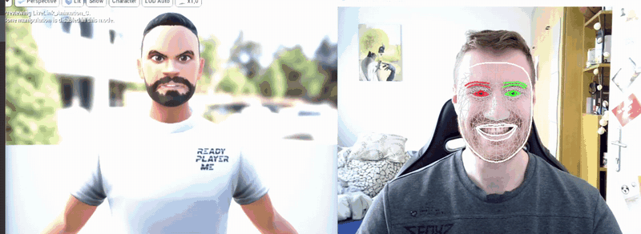
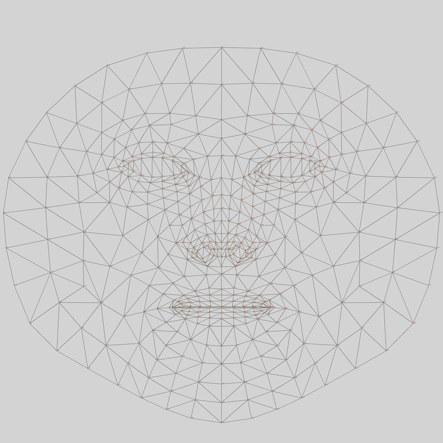
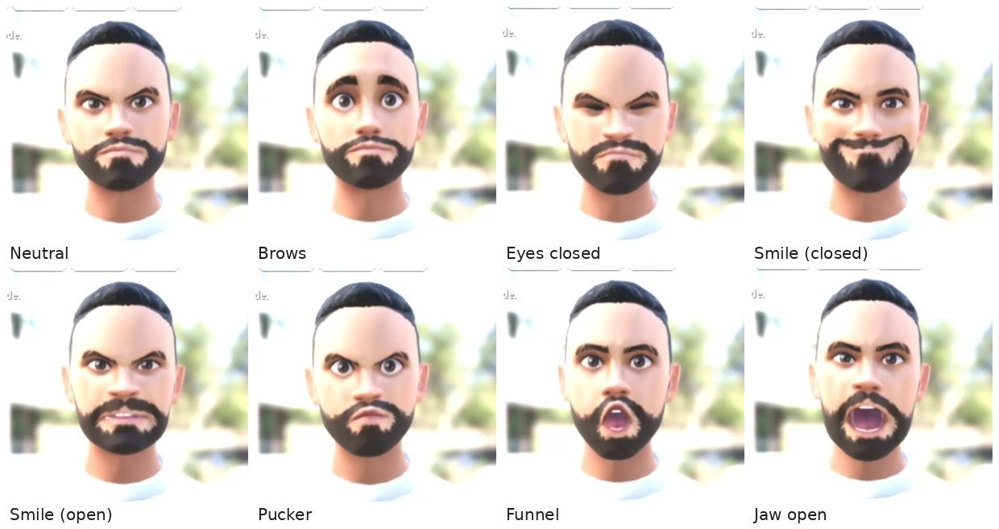

# Webcam Facial Mocap for Unreal Engine

Turn any webcam into a facial motion-capture device: your facial expressions drive a 3D character in Unreal Engine in real time.



*Real-time speed, three short clips: smile, mouth funnel, jaw open.*

## TL;DR

- **Webcam in, animated character out.** No depth camera, no markers, no iPhone.
- **Real-time:** the application runs at **up to 315 FPS** on a desktop PC (i5-13600KF, RTX 3070). End-to-end latency: **[latency in ms, not measured yet]**.
- **Tested** with 4 people and 8 key expressions. Eyes and jaw track reliably. Fine mouth shapes (pucker, funnel) still need per-user calibration.

## Why this matters

Facial motion capture usually needs dedicated hardware: head-mounted cameras, marker setups, or an iPhone with a depth sensor.
This project shows that a standard webcam and open-source tools get you a working real-time pipeline.

Where that is useful:

- **Games**: player faces on in-game avatars
- **VTubing and streaming**: live avatars without extra hardware
- **Virtual production**: quick facial previs before a full mocap session
- **Avatars in VR, video calls and virtual events**

## How it works


1. **Detect.** MediaPipe Face Mesh finds 468 3D landmarks per frame. No training or calibration step is needed.
2. **Map.** MeFaMo turns distances between key landmarks (e.g. lip gap vs. head height) into ARKit-style blendshape values from 0 to 1 (`JawOpen`, `EyeBlinkLeft`, `MouthSmileRight`, …). It also estimates head pitch, yaw and roll.
3. **Stream.** PyLiveLinkFace sends the values over UDP using the same protocol as Epic's *Live Link Face* iPhone app. Unreal therefore treats the webcam like an iPhone.
4. **Animate.** A custom Animation Blueprint applies the blendshapes to the Ready Player Me character and rotates its head, neck and spine bones.



*MediaPipe's 468-point face mesh (image: Google, Apache 2.0).*

**What I built and what I reused:**

- **Built:** tracker evaluation (StrongTrack vs. dlib vs. MediaPipe; test scripts in `experiments/`), the Unreal project with the Live Link animation blueprint and the head/neck/spine rotation, the Ready Player Me integration, and the test series with 4 people.
- **Reused:** MediaPipe (Google), [MeFaMo](https://github.com/JimWest/MeFaMo) and [PyLiveLinkFace](https://github.com/JimWest/PyLiveLinkFace) by Marco Pattke (MIT, included unmodified in `third_party/`).

## Results



*Character side for 8 key poses from one test subject. The webcam half was cropped for privacy.*

**Setup:** Windows 11, Intel i5-13600KF, 16 GB RAM, NVIDIA RTX 3070.

| Metric | Value |
|---|---|
| Frame rate | up to **315 FPS** |
| CPU load | 13.5 % |
| GPU load | 93 % |
| RAM | 820 MB |
| End-to-end latency | **[not measured]** |

**Per expression (4 subjects, one also with and without glasses):**

| Expression | Result |
|---|---|
| Mouth wide open | ✅ works for all subjects |
| Eyes closed | ✅ works, except with glasses |
| Smile, closed mouth | ✅ accurate for 3 of 4 subjects |
| Smile, open mouth | ⚠️ mixed |
| Eyebrows | ⚠️ offset at neutral for 3 of 4 subjects |
| Mouth funnel | ⚠️ partly: close for some subjects, missed for others |
| Mouth pucker | ❌ not satisfying for any subject |

## Limitations & next steps

**Limitations**

- **No per-user calibration.** MeFaMo's min/max values were tuned on its author's face, so quality varies from person to person. This is the main cause of the brow offsets and weak mouth shapes.
- **Glasses** confuse the tracker: the frame gets detected as the eyebrows.
- **Chin landmarks** sit too high when the mouth is wide open.
- **Custom avatars:** Ready Player Me avatars loaded via URL only receive head rotation, not facial blendshapes. Only the avatars bundled with the plugin work fully.
- Built on **UE 4.27** and **mediapipe 0.9**. Both are now outdated.

**Next steps**

- [ ] Add a calibration step: record a neutral face and the extreme poses, then rescale the blendshapes per user
- [ ] Replace the hand-written mapping with MediaPipe's newer Face Landmarker, which outputs blendshapes directly
- [ ] Measure end-to-end latency (camera → character)
- [ ] Port to Unreal Engine 5 and MetaHuman
- [ ] Fix blendshapes for URL-loaded avatars

## Tech stack

| Layer | Tools |
|---|---|
| Landmark detection | MediaPipe Face Mesh 0.9.0.1, OpenCV 4.7 |
| Blendshape mapping | MeFaMo, NumPy, Open3D 0.17, transforms3d |
| Streaming | PyLiveLinkFace (Live Link Face protocol over UDP) |
| Engine | Unreal Engine 4.27 (C++ project), Live Link, Apple ARKit + ARKit Face Support plugins |
| Character | Ready Player Me Unreal SDK 1.1.0, glTFRuntime |
| Language | Python 3.9, C++, Blueprints |

## Run it yourself

**Requirements:** Windows (tested on Windows 11), a webcam, Python 3.9, Unreal Engine **4.27**, Visual Studio with the "Game development with C++" workload.

**1. Python side**

```powershell
python -m venv .venv
.venv\Scripts\activate
pip install -r requirements.txt
pip install ./third_party/MeFaMo
```

**2. Unreal side**

1. Open `unreal/LiveLink_RPM/LiveLink_RPM.uproject` and click **Yes** when asked to rebuild modules. Build output is not in the repo, so the first start compiles the project and plugins.
2. Restore the Epic template content, which is not redistributed here: **Content Browser → Add New → Add Feature or Content Pack → C++ Feature → Third Person → Add to Project**.
3. Under **Edit → Plugins**, check that *Live Link*, *Apple ARKit*, *Apple ARKit Face Support*, *Ready Player Me* and *glTFRuntime* are enabled, then restart the editor.
4. Open the animation blueprint at `ReadyPlayerMe Content/Character/Fullbody/Animations/LiveLink_Animation`.
   Live Link setup reference: [Epic docs for Live Link Face, UE 4.27](https://docs.unrealengine.com/4.27/en-US/AnimatingObjects/SkeletalMeshAnimation/FacialRecordingiPhone/).

**3. Start tracking**

```powershell
python third_party/MeFaMo/examples/mefamo_cli.py --show_debug
```

| Option | Default | Purpose |
|---|---|---|
| `--input` | `0` | Webcam index, or path to a video or image |
| `--ip` / `--port` | `127.0.0.1` / `11111` | Live Link target (Unreal can run on another PC) |
| `--show_debug` | off | Show live blendshape values |
| `--show_3d` | off | Show normalised 3D landmarks |

## Repository structure

```
├── assets/                  README images and demo GIF
├── docs/                    Bachelor's thesis (PDF)
├── experiments/             Tracker comparison scripts (MediaPipe, dlib)
├── third_party/MeFaMo/      Landmark → blendshape mapping (upstream, MIT)
├── unreal/LiveLink_RPM/     Unreal Engine 4.27 project
│   ├── Content/ReadyPlayerMe/   Level, character and game mode
│   ├── Plugins/                 Ready Player Me + glTFRuntime (source and content)
│   └── Source/                  C++ game module
└── requirements.txt
```

## About this project

This repository accompanies my **Bachelor's thesis** *"Facial Landmark Tracking and how to animate a character"*, **Graz University of Technology**, Institute of Computer Graphics and Knowledge Visualisation, **2023**.

📄 [Read the thesis (PDF)](docs/thesis_facial_landmark_tracking.pdf)

**Credits:** [MediaPipe](https://github.com/google/mediapipe) (Google), [MeFaMo](https://github.com/JimWest/MeFaMo) and [PyLiveLinkFace](https://github.com/JimWest/PyLiveLinkFace) (Marco Pattke), [Ready Player Me](https://readyplayer.me), [glTFRuntime](https://github.com/rdeioris/glTFRuntime) (Roberto De Ioris). Third-party licenses are in the respective folders.

